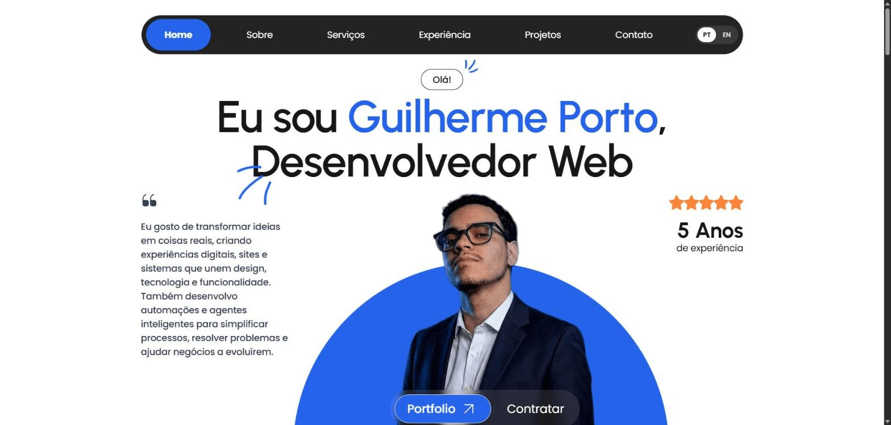

# Portfólio — Guilherme Porto



Site de portfólio pessoal de **Guilherme Porto** (desenvolvedor web e automações), construído a partir do protótipo Figma "Guilherme Porto — Brand System" (frame *Desktop - 2*). Landing page de página única, tema claro com azul elétrico, bilíngue, pré-renderizada em build e otimizada para SEO e performance.

**Produção:** [guilherme-porto.dev.br](https://guilherme-porto.dev.br/) · **EN:** [guilherme-porto.dev.br/en](https://guilherme-porto.dev.br/en)

## Seções

1. **Nav** em pill flutuante com scroll-spy, seletor PT/EN e menu mobile.
2. **Hero** — "Eu sou Guilherme Porto, Desenvolvedor Web", foto sobre semicírculo azul, estrelas e anos de experiência, botões Portfolio / Contratar.
3. **Meus Serviços** — seção escura com textura, cards recortados em carrossel (UI/UX Design, Sistemas Web, Desenvolvimento Web, Agentes Inteligentes, Conversão e Performance, Manutenção).
4. **Minha Experiência** — timeline com três cargos.
5. **Por que me contratar?** — foto, texto, números e botão Contratar.
6. **Portfólio** — carrossel com os projetos em destaque, filtros por categoria e modal de detalhes; "Ver tudo" leva à página **/projetos** (`/en/projects`) com todos os projetos em grade de 3 colunas.
7. **Marquee** — faixa inclinada com as especialidades.
8. **Feedbacks** — 12 depoimentos em cards vidro numa esteira automática contínua (direita → esquerda, pausa no hover).
9. **CTA** — botão "Entrar em contato" que abre o WhatsApp com a mensagem pronta.
10. **Footer** — redes sociais, navegação e contato.

## Stack

- [React 18](https://react.dev/) + [TypeScript](https://www.typescriptlang.org/)
- [Vite 6](https://vite.dev/) (build, dev server e bundle SSR do pré-render)
- [Tailwind CSS v4](https://tailwindcss.com/) via `@tailwindcss/vite` (tokens do design system em `@theme`, container queries nos cards)
- Fontes **Poppins** e **Urbanist** self-hosted (woff2, subset latin) copiadas do [Fontsource](https://fontsource.org/)
- [lucide-react](https://lucide.dev/) (4 ícones) + SVGs exportados do Figma em `src/assets/icons/`
- [sharp](https://sharp.pixelplumbing.com/), [satori](https://github.com/vercel/satori) e [resvg](https://github.com/yisibl/resvg-js) só em dev, para imagens, OG image e favicons

## Destaques

### Páginas e navegação
- Duas rotas por idioma, sem biblioteca de roteamento (`src/router.ts`): home (`/`, `/en`) e projetos (`/projetos`, `/en/projects`). Troca de página por `pushState` com o mesmo bundle; acesso direto recebe o HTML pré-renderizado.
- Um projeto aparece na home quando tem `featured: true` em `content.ts`; todos aparecem em `/projetos`.

### Bilíngue (PT-BR / EN)
- Context próprio (`src/i18n/LanguageContext.tsx`) com dicionários tipados em `src/data/content.ts`; sem biblioteca de i18n.
- URLs próprias por idioma e página (`/`, `/en`, `/projetos`, `/en/projects`), ligadas por `hreflang`. Cada uma é **pré-renderizada no build** com `<html lang data-route>`, title, description, canonical, Open Graph, Twitter e JSON-LD próprios.
- O idioma inicial segue o HTML recebido (hidratação sem divergência); a preferência salva ou o idioma do navegador é aplicado logo depois. Trocar pelo botão atualiza URL e metas sem recarregar.

### SEO
- Metas por idioma geradas por `src/seo/meta.ts` (`getSeo`), usado pelo pré-render e pela troca de idioma.
- JSON-LD em `@graph`: `WebSite`, `WebPage`/`CollectionPage`, `Person`, `ProfessionalService` (com catálogo dos serviços), `ItemList` dos projetos e `BreadcrumbList` na página de projetos.
- OG image 1200×630, favicon SVG/ICO, apple-touch-icon e manifest gerados por `npm run assets:seo`.
- `sitemap.xml` gerado no build com as 4 URLs, `lastmod` e alternates; `robots.txt` em `public/`.
- Um H1 real no hero e H2 em cada seção; `alt` descritivo em todas as imagens.

### Performance
- HTML pré-renderizado com o **CSS inline** (sem requisição render-blocking); hidratação com `hydrateRoot`.
- Imagens em **AVIF/WebP** em 1× e 2× (`scripts/images.config.mjs` + `scripts/optimize-images.mjs`), `loading="lazy"` abaixo da dobra, preload e `fetchpriority="high"` na foto do hero.
- Fontes com preload (Urbanist 600 e Poppins 400) e cache imutável; `content-visibility: auto` nas seções abaixo da dobra; modal de projeto em chunk separado.
- Animações só em `opacity`/`transform`, com `prefers-reduced-motion` respeitado.
- Lighthouse (local, com gzip): desktop 100/100/100/100 · mobile 96/100/100/100, CLS 0.

### Acessibilidade
- Nav, carrosséis (setas ←/→), filtros, modal (`<dialog>`) e botões navegáveis por teclado, com `:focus-visible` consistente.
- Alvos de toque de pelo menos 44px, contraste AA, marcação ARIA nos carrosséis e no menu mobile.

## Rodando o projeto

```bash
npm install
npm run dev        # dev server em http://localhost:5173
```

### Scripts

| Script | Descrição |
|---|---|
| `npm run dev` | Dev server com HMR |
| `npm run build` | Typecheck + build de produção + pré-render das 4 páginas (PT/EN × home/projetos) e sitemap em `dist/` |
| `npm run preview` | Serve o build em http://localhost:4173 (use `/en/` com barra; a Vercel serve `/en`) |
| `npm run optimize:images` | Regenera AVIF/WebP a partir de `assets-src/` e `scripts/images.config.mjs` |
| `npm run assets:seo` | Regenera `og-image.png`, favicons e `site.webmanifest` |
| `npm run fonts` | Copia os woff2 do Fontsource para `public/fonts/` |

> Meça o Lighthouse em um servidor com compressão (produção ou `npx serve dist`), nunca no dev server.

## Estrutura

```
├── index.html                  # Head com metas padrão (PT), ícones, preloads
├── vercel.json                 # /en, /projetos e /en/projects estáticos, rewrite SPA, cache headers
├── assets-src/                 # Fontes das imagens (fotos, mockups, textura, capas)
├── public/
│   ├── hero/ about/ bg/ services/ projects/   # AVIF/WebP gerados
│   ├── fonts/                  # woff2 self-hosted
│   └── og-image.png, favicon.*, site.webmanifest, robots.txt
├── scripts/
│   ├── prerender.mjs           # Pré-render PT/EN, CSS inline, sitemap
│   ├── images.config.mjs       # Lista declarativa das imagens
│   ├── optimize-images.mjs     # Gera AVIF/WebP com sharp
│   ├── seo-assets.mjs          # OG image, favicons e manifest (satori + resvg)
│   └── copy-fonts.mjs
├── docs/plano-redesign-portfolio.md   # Plano e checklist do redesign
└── src/
    ├── App.tsx                 # Ordem das seções
    ├── index.css               # @font-face, tokens (@theme), utilitários, animações
    ├── data/content.ts         # Todo o conteúdo em PT e EN + links
    ├── router.ts               # Rotas home/projects por idioma
    ├── seo/meta.ts             # Metas e JSON-LD por idioma e rota
    ├── pages/HomePage.tsx, pages/ProjectsPage.tsx
    ├── i18n/LanguageContext.tsx
    ├── assets/icons/           # SVGs do Figma
    └── components/
        ├── Header, Hero, Services, Experience, About, Projects,
        │   Marquee, Feedback, Cta, Footer
        ├── Carousel            # Scroll-snap + dots + teclado
        ├── ProjectCard (card + filtros), ProjectModal, ProjectImage, DarkTexture
        └── Button, SectionTitle, Reveal, BrandIcons
```

## Editando o conteúdo

Textos, links, serviços, experiência, projetos, depoimentos e marquee ficam em **`src/data/content.ts`** (`content.pt` e `content.en`). Para adicionar um projeto: coloque a imagem original em `assets-src/projects/`, registre em `scripts/images.config.mjs`, rode `npm run optimize:images` e adicione o item (com `category` e `featured`) nos dois idiomas. Projetos com `featured: true` aparecem na home; todos aparecem em `/projetos`.

## Deploy

1. Vercel detecta o Vite; `vercel.json` já serve `/en` como página estática e aplica cache imutável nos assets.
2. Após publicar, envie o `sitemap.xml` no [Google Search Console](https://search.google.com/search-console) e valide o JSON-LD no [Rich Results Test](https://search.google.com/test/rich-results) e a OG image nos debuggers do LinkedIn/Facebook.
